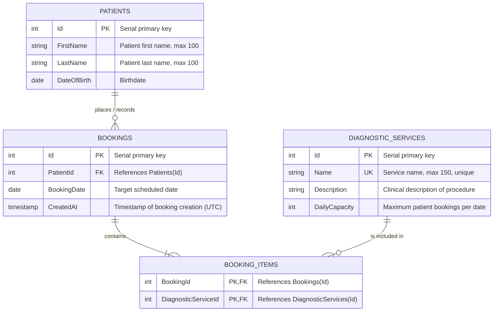

# Entity-Relationship Diagram (ERD)
## CareFlow — Performance Task 4: Diagnostic Booking Management

This document defines the relational database schema implemented in **PostgreSQL 18** via **Entity Framework Core 8** for Performance Task 4.

---

### 1. Conceptual Model Diagram

---

### 2. Relational Schema & Tables

#### Table: `Patients`
| Column | Type | Constraints | Description |
|---|---|---|---|
| `Id` | `integer` | `PRIMARY KEY GENERATED BY DEFAULT AS IDENTITY` | Patient identifier |
| `FirstName` | `varchar(100)` | `NOT NULL` | First name |
| `LastName` | `varchar(100)` | `NOT NULL` | Last name / Surname |
| `DateOfBirth` | `date` | `NOT NULL` | Date of birth |

#### Table: `DiagnosticServices`
| Column | Type | Constraints | Description |
|---|---|---|---|
| `Id` | `integer` | `PRIMARY KEY GENERATED BY DEFAULT AS IDENTITY` | Service identifier |
| `Name` | `varchar(150)` | `NOT NULL`, `UNIQUE INDEX` | Diagnostic procedure name |
| `Description` | `text` | `NOT NULL` | Detailed procedure description |
| `DailyCapacity` | `integer` | `NOT NULL` | Maximum allowed bookings per day |

#### Table: `Bookings`
| Column | Type | Constraints | Description |
|---|---|---|---|
| `Id` | `integer` | `PRIMARY KEY GENERATED BY DEFAULT AS IDENTITY` | Booking number |
| `PatientId` | `integer` | `NOT NULL`, `FOREIGN KEY` | References `Patients(Id)` (`ON DELETE RESTRICT`) |
| `BookingDate` | `date` | `NOT NULL` | Date of scheduled appointment |
| `CreatedAt` | `timestamp with time zone` | `NOT NULL` | UTC creation timestamp |

#### Table: `BookingItems` (Join Table)
| Column | Type | Constraints | Description |
|---|---|---|---|
| `BookingId` | `integer` | `NOT NULL`, `FOREIGN KEY` | References `Bookings(Id)` (`ON DELETE CASCADE`) |
| `DiagnosticServiceId` | `integer` | `NOT NULL`, `FOREIGN KEY` | References `DiagnosticServices(Id)` (`ON DELETE RESTRICT`) |

*Composite Primary Key: (`BookingId`, `DiagnosticServiceId`)*
