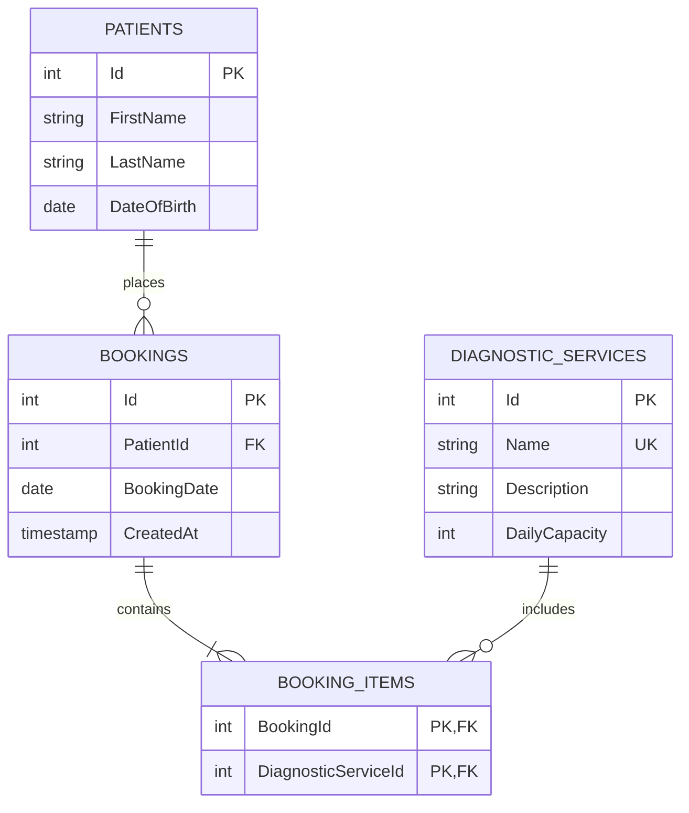

# CareFlow - Diagnostic Booking Management System
**ITSD81: Desktop Application Development**  
**Performance Task 4: Data-Driven Application Architecture and Transactional Workflows**

---

## 1. Project Overview
CareFlow is a specialized desktop application built for a hospital outpatient diagnostic department. The application enables staff to manage patient bookings for diagnostic procedures (e.g., Complete Blood Count, Urinalysis, Chest X-Ray, ECG) while strictly enforcing daily service capacities and transaction atomicity.

When a patient requests multiple diagnostic services for a single date, CareFlow ensures:
1. **All or Nothing Atomicity:** All requested services must be accommodated; if even one service has reached daily capacity, the entire booking is rejected with zero partial persistence.
2. **Dynamic Remaining Capacity:** Real-time remaining capacities are calculated from persisted database records.
3. **Data Integrity via Transactions:** Booking header and service associations are coordinated within an explicit relational database transaction with rollback protection.
4. **Permanent Persistence:** Confirmed bookings survive application shutdown and restarts.

---

## 2. Architecture & Separation of Concerns
The solution is organized following clean architectural boundaries:
- **CareFlow.Domain:** Pure domain entities (`Patient`, `DiagnosticService`, `Booking`, `BookingItem`). Contains zero dependencies on UI or database frameworks.
- **CareFlow.Application:** Business rule validation (`BR-01` through `BR-10`), repository interfaces (`IBookingRepository`), DTOs, application services (`BookingService`), and UI ViewModels (`CommunityToolkit.Mvvm`).
- **CareFlow.Infrastructure:** Entity Framework Core DbContext (`CareFlowDbContext`), PostgreSQL provider (`Npgsql.EntityFrameworkCore.PostgreSQL`), design-time factory, migrations, and atomic transaction repository implementation (`BookingRepository`).
- **CareFlow.Desktop:** Avalonia UI (v11) cross-platform desktop presentation layer, XAML views, and dependency injection setup.
- **CareFlow.Tests:** xUnit acceptance test suite covering scenarios `AC-01` through `AC-06`.

---

## 3. Relational Database Design
### Entity-Relationship Diagram (ERD)



---

## 4. Business Rules Implementation Matrix

| Rule ID | Description | Implementation Details |
|---|---|---|
| **BR-01** | Must reference existing patient | Validated in `BookingService.CreateBookingAsync` by querying persisted patient registry. |
| **BR-02** | 1 to 3 distinct diagnostic services | Enforced in `BookingService.CreateBookingAsync` (checks `serviceIds.Count >= 1 && <= 3`). |
| **BR-03** | Date cannot be in the past | Checked via `date < DateOnly.FromDateTime(DateTime.Now)`. |
| **BR-04** | Service consumes 1 unit capacity | Each `BookingItem` record represents 1 capacity unit consumed for that service date. |
| **BR-05** | Bookings cannot exceed daily capacity | Capacity threshold evaluated against persistent count before and during commit. |
| **BR-06** | No duplicate service per request | Enforced using `serviceIds.Distinct().Count() == serviceIds.Count`. |
| **BR-07** | Atomic transaction | Coordinated in `BookingRepository.CreateBookingAsync` using `BeginTransactionAsync()`, `CommitAsync()`, and `RollbackAsync()`. |
| **BR-08** | Stale availability revalidation | Service capacities are re-verified inside the active transaction boundary before persisting booking items. |
| **BR-09** | Persistent between restarts | Fully backed by PostgreSQL database with EF Core migrations and seed data. |
| **BR-10** | Understandable user feedback | Return values encapsulated in `BookingResultDto(Success, Message, BookingId)` and surfaced cleanly in the UI. |

---

## 5. Acceptance Verification Checklist

| Scenario ID | Test Scenario | Expected Result | Verification Method | Status |
|---|---|---|---|---|
| **AC-01** | View diagnostic services for selected date | Remaining capacity accurately computed from persisted bookings | Verified via `AC01_ViewDiagnosticServices_CalculatesRemainingCapacityCorrectly` & UI DatePicker | **VERIFIED** |
| **AC-02** | Create booking with multiple available services | One confirmed booking with all services persisted | Verified via `AC02_CreateBooking_WithMultipleAvailableServices_Succeeds` & View Bookings tab | **VERIFIED** |
| **AC-03** | Request fully booked service or invalid data | Entire request rejected; 0 records created | Verified via `AC03_RequestFullyBookedService_OrInvalidInfo_Rejected` | **VERIFIED** |
| **AC-04** | Attempt booking after displayed capacity becomes unavailable | System revalidates inside transaction and blocks overbooking | Verified via `AC04_AttemptBookingAfterCapacityBecomesUnavailable_RevalidatesAndRejects` | **VERIFIED** |
| **AC-05** | Database failure before commit | Full transaction rollback; no orphaned records | Verified via `AC05_OperationFailure_RollsBackTransaction_NoPartialRecords` | **VERIFIED** |
| **AC-06** | Restart application | Persisted bookings and service items remain intact | Verified via `AC06_PersistedBookings_AreRetrievable` & PostgreSQL persistence | **VERIFIED** |

---

## 6. How to Configure, Build, and Run

### Prerequisites
- [.NET 8.0 or .NET 10.0 SDK](https://dotnet.microsoft.com/)
- [PostgreSQL](https://www.postgresql.org/) (Running on `localhost:5432`)
- Default database user: `postgres` with password `password` (or custom configured in connection string)

### Database Configuration & Migration
1. Ensure the PostgreSQL database exists:
   ```bash
   psql -U postgres -c "CREATE DATABASE careflow_db;"
   ```
2. Apply EF Core Migrations (or run the desktop application directly, which applies migrations automatically on startup):
   ```bash
   dotnet ef database update --project CareFlow.Infrastructure --startup-project CareFlow.Desktop
   ```

### Running the Acceptance Tests
Run the test suite from the root of the project:
```bash
dotnet test
```
*Expected: 6 Passed, 0 Failed.*

### Running the Desktop Application
Launch the Avalonia UI desktop client:
```bash
dotnet run --project CareFlow.Desktop
```

---

## 7. Project Structure
```
PT4/
├── appsettings.json.example
├── README.md
├── CareFlow.sln
├── CareFlow.Domain/
│   └── Entities/
│       ├── Patient.cs
│       ├── DiagnosticService.cs
│       ├── Booking.cs
│       └── BookingItem.cs
├── CareFlow.Application/
│   ├── DTOs/
│   │   └── BookingDtos.cs
│   ├── Interfaces/
│   │   └── IBookingRepository.cs
│   ├── Services/
│   │   └── BookingService.cs
│   └── ViewModels/
│       ├── MainViewModel.cs
│       ├── AvailabilityViewModel.cs
│       ├── CreateBookingViewModel.cs
│       └── BookingListViewModel.cs
├── CareFlow.Infrastructure/
│   ├── Data/
│   │   ├── CareFlowDbContext.cs
│   │   └── CareFlowDbContextFactory.cs
│   ├── Migrations/
│   └── Repositories/
│       └── BookingRepository.cs
├── CareFlow.Desktop/
│   ├── App.axaml / App.axaml.cs
│   ├── MainWindow.axaml / MainWindow.axaml.cs
│   └── Views/
│       ├── AvailabilityView.axaml / AvailabilityView.axaml.cs
│       ├── CreateBookingView.axaml / CreateBookingView.axaml.cs
│       └── BookingListView.axaml / BookingListView.axaml.cs
└── CareFlow.Tests/
    └── AcceptanceTests.cs
```
